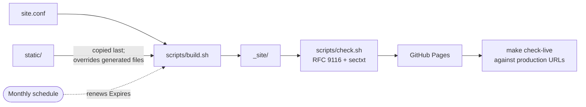

<div align="center">

# Root Files for GitHub Pages

A template repository that publishes `security.txt`, `robots.txt`, `sitemap.xml` and
`llms.txt` at the root of a `*.github.io` origin. The files are generated from a single
configuration file and renewed by CI.

[](https://github.com/sarathsp06/sarathsp06.github.io/actions/workflows/pages.yml)
[](https://www.rfc-editor.org/rfc/rfc9116)
[](https://www.rfc-editor.org/rfc/rfc9309)
[](LICENSE)

[Use this template](https://github.com/sarathsp06/sarathsp06.github.io/generate)
&nbsp;·&nbsp; [Live example](https://sarathsp06.github.io/.well-known/security.txt)
&nbsp;·&nbsp; [Quick start](#quick-start)
&nbsp;·&nbsp; [Configuration](#configuration)
&nbsp;·&nbsp; [Contributing](#contributing)

</div>

---

## Contents

- [Overview](#overview)
- [Published files](#published-files)
- [Design principles](#design-principles)
- [How it works](#how-it-works)
- [Quick start](#quick-start)
- [Configuration](#configuration)
- [Commands](#commands)
- [Customization](#customization)
- [Troubleshooting](#troubleshooting)
- [Scope](#scope)
- [Contributing](#contributing)
- [License](#license)

## Overview

GitHub Pages serves each project repository under its own path, for example
`https://<user>.github.io/<project>/`. Several conventions, however, are defined relative to the
**origin root**. Clients look for these files only at the root and ignore copies under a
project path:

| Published by a project site | Location that clients actually read |
|---|---|
| `<user>.github.io/<project>/.well-known/security.txt` | `<user>.github.io/.well-known/security.txt` |
| `<user>.github.io/<project>/robots.txt` | `<user>.github.io/robots.txt` |

Only the repository named `<user>.github.io` can publish to the origin root. If that
repository does not exist, or does not contain these files:

- **Vulnerability reports have no defined channel.** Researchers and automated scanners
  look for `/.well-known/security.txt`. If it is missing, reports may be filed publicly or not
  at all.
- **Project sitemaps are not discovered.** Crawlers read only the root `robots.txt`, so
  `Sitemap:` directives in project-level files have no effect.
- **AI tools get no project index.** The `llms.txt` convention is also defined at the
  origin root.

RFC 9116 also makes the `Expires` field of `security.txt` mandatory and recommends a lifetime of
less than one year. A file maintained by hand will eventually go out of date and become invalid.
This repository regenerates it on a schedule, so the expiry date is always in the future.

## Published files

| Path | Specification | Purpose |
|---|---|---|
| [`/.well-known/security.txt`](https://sarathsp06.github.io/.well-known/security.txt) | [RFC 9116](https://www.rfc-editor.org/rfc/rfc9116) | Security contacts for every site under the origin. `Expires` is recalculated on each build. Checked by [internet.nl](https://internet.nl) and by security tooling |
| [`/robots.txt`](https://sarathsp06.github.io/robots.txt) | [RFC 9309](https://www.rfc-editor.org/rfc/rfc9309) | Crawl rules for the origin, plus a `Sitemap:` entry for each project site |
| `/sitemap.xml` | [sitemaps.org](https://www.sitemaps.org/protocol.html) | A sitemap index of project sitemaps, so a single URL can be submitted to search consoles |
| [`/llms.txt`](https://sarathsp06.github.io/llms.txt) | [llmstxt.org](https://llmstxt.org/) | Optional Markdown index of projects for language-model tooling |
| `/404.html` | GitHub Pages | A neutral not-found page for paths that do not belong to any project |

This is the `security.txt` generated for this repository:

```text
# Security contact for https://sarathsp06.github.io/ and every project site under it.
# Generated from site.conf; edit that, not this file.
# Sparrow also takes private advisories: https://github.com/sarathsp06/sparrow/security/advisories/new
# Sparrow's disclosure policy: https://github.com/sarathsp06/sparrow/blob/main/SECURITY.md
Contact: mailto:sarath.sp06@gmail.com
Expires: 2027-04-17T11:47:44Z
Preferred-Languages: en
Canonical: https://sarathsp06.github.io/.well-known/security.txt
```

## Design principles

| Principle | Implementation |
|---|---|
| **Single source of truth** | Every output is generated from [`site.conf`](site.conf). Generated files are never edited by hand. |
| **Continuous validity** | A scheduled monthly build moves `Expires` forward. With the default settings, at least 150 days always remain. |
| **Validation before and after deployment** | The build enforces the RFC 9116 rules and runs [`sectxt`](https://github.com/DigitalTrustCenter/sectxt), the validator used by internet.nl. After deployment, the live URLs are checked again for HTTP status, `Content-Type` and validity. |
| **Safe to copy** | Deployment is refused until `site.conf` names the repository owner, so a new copy cannot publish another account's security contacts. |
| **Minimal dependencies** | Uses POSIX `sh` and `make` only, with no Jekyll, Node.js or Ruby. Works with both GNU and BSD `date`. |
| **Hardened CI** | Actions are pinned to commit SHAs, permissions are scoped per job, and deployment uses GitHub's OIDC-based Pages flow. |

## How it works



The workflow [`.github/workflows/pages.yml`](.github/workflows/pages.yml) runs on every push to
`main`, on pull requests (build and validation only), on the first day of each month, and on
manual dispatch. It has three jobs:

1. **build** runs `make check`. The job fails if `security.txt` is invalid, expires in fewer
   than 30 or more than 365 days, or still contains `example.com` placeholders.
2. **deploy** publishes `_site/` to GitHub Pages.
3. **verify** runs `make check-live` against the production URLs and retries for up to six
   minutes while the Pages CDN refreshes. On scheduled runs it also re-enables the workflow.
   GitHub disables scheduled workflows after 60 days without repository activity, which would
   otherwise let `security.txt` expire.

## Quick start

**Prerequisites:** a GitHub account (personal or organization), plus `git`, `make` and a POSIX
shell on your machine. `python3` is needed only for local preview.

### 1. Create the repository

Select [**Use this template**](https://github.com/sarathsp06/sarathsp06.github.io/generate) and
name the repository exactly `<username>.github.io`, or `<organization>.github.io`.

> [!NOTE]
> Forking also works. GitHub disables Actions on forks by default, so you must enable them
> from the repository's **Actions** tab.

> [!IMPORTANT]
> If a `<username>.github.io` repository already exists, copy `site.conf`, `scripts/`,
> `static/`, `Makefile` and `.github/workflows/pages.yml` into it. Move existing site
> content into `static/` so that it is published alongside the generated files.

### 2. Enable deployment through GitHub Actions

In the repository, go to **Settings → Pages → Build and deployment → Source** and select
**GitHub Actions**.

### 3. Configure

```bash
git clone https://github.com/<username>/<username>.github.io.git
```

```bash
cd <username>.github.io
```

```bash
make configure \
  SECURITY_CONTACTS="security@example.org https://github.com/<username>/<repo>/security/advisories/new" \
  SITEMAPS="https://<username>.github.io/<repo>/sitemap-index.xml" \
  SECURITY_NOTES="" PROJECTS=""
```

`OWNER` is taken from the git remote. Setting `SECURITY_NOTES` and `PROJECTS` to empty strings
clears the sample values that come with the template. To set multi-line values such as
`PROJECTS`, edit [`site.conf`](site.conf) directly. All keys are described under
[Configuration](#configuration).

### 4. Build and validate

```bash
make check
```

To review the output locally, start a preview server and open
<http://localhost:8000/.well-known/security.txt>:

```bash
make serve
```

> [!TIP]
> For the same strict validation that CI performs, install the reference validator with
> `pip install sectxt`.

### 5. Deploy

```bash
git commit -am "Configure root files" && git push
```

After the workflow completes, these URLs are served:

- `https://<username>.github.io/.well-known/security.txt`
- `https://<username>.github.io/robots.txt`
- `https://<username>.github.io/sitemap.xml` (when `SITEMAPS` is set)
- `https://<username>.github.io/llms.txt` (when `PROJECTS` is set)

After this, you only need to change `site.conf` when your contacts or projects change. Expiry
renewal requires no action.

## Configuration

Settings are stored in [`site.conf`](site.conf) as shell assignments (`KEY="value"`). They can
be set with `make configure KEY=value …` or by editing the file directly.

| Key | Required | Default | Description |
|---|:---:|---|---|
| `OWNER` | Yes | Owner from the git remote | GitHub account the configuration belongs to. Deployment is refused if it differs from the repository owner. |
| `SITE_URL` | No | `https://<OWNER>.github.io` | Base URL, without a trailing slash. Set this when you use a custom domain. |
| `SECURITY_CONTACTS` | Yes | — | Space-separated contacts, most preferred first. Accepts a bare email address, or a `mailto:`, `https://` or `tel:` URI. A [GitHub private vulnerability reporting](https://docs.github.com/en/code-security/security-advisories/guidance-on-reporting-and-writing-information-about-vulnerabilities/privately-reporting-a-security-vulnerability) link is a suitable `https://` contact. |
| `SECURITY_POLICY` | No | — | URL of the vulnerability disclosure policy. |
| `SECURITY_ACKNOWLEDGMENTS` | No | — | URL of a page acknowledging reporters. |
| `SECURITY_ENCRYPTION` | No | — | `https` URL of an OpenPGP public key. |
| `SECURITY_NOTES` | No | — | Comment lines placed at the top of `security.txt`, separated by `;`. Useful for directing reporters to project-specific channels. |
| `PREFERRED_LANGUAGES` | No | `en` | Comma-separated [RFC 5646](https://www.rfc-editor.org/rfc/rfc5646) language tags. |
| `EXPIRES_DAYS` | No | `180` | Days from each build to `Expires`. Use a value from 31 to 365; the validator rejects anything outside that range. |
| `SITEMAPS` | No | — | Space-separated project sitemap URLs. Each is listed in `robots.txt` and indexed in `/sitemap.xml`. |
| `SITE_TITLE` | No | `<OWNER>` | Heading of `llms.txt`. |
| `SITE_DESCRIPTION` | No | — | One-line summary in `llms.txt`. |
| `PROJECTS` | No | — | One project per line, in the form `Name \| URL \| description`. If empty, `llms.txt` is not generated. |

<details>
<summary><b>Example: an account with several project sites</b></summary>

```sh
OWNER="octocat"
SECURITY_CONTACTS="security@octocat.dev https://github.com/octocat/widget/security/advisories/new"
SECURITY_POLICY="https://github.com/octocat/.github/blob/main/SECURITY.md"
SECURITY_NOTES="Widget accepts private advisories: https://github.com/octocat/widget/security/advisories/new"
PREFERRED_LANGUAGES="en, de"
EXPIRES_DAYS="180"
SITEMAPS="https://octocat.github.io/widget/sitemap.xml https://octocat.github.io/gizmo/sitemap.xml"
SITE_TITLE="Octocat open-source tools"
SITE_DESCRIPTION="Developer tools, each documented on its own site under this origin."
PROJECTS="
Widget | https://octocat.github.io/widget/llms.txt | Self-hosted widget server
Gizmo  | https://octocat.github.io/gizmo/          | Command-line tool for gizmo files
"
```

</details>

> [!NOTE]
> `make configure` rejects values that contain `"`, `\`, `$` or a backtick. This keeps
> `site.conf` safe to source as a shell file.

## Commands

| Command | Description |
|---|---|
| `make configure KEY=value …` | Write settings to `site.conf`. |
| `make build` | Render the site into `_site/`. |
| `make check` | Build, then validate the output (RFC 9116 rules, plus `sectxt` if installed). |
| `make check-live` | Validate the files currently served by GitHub Pages. |
| `make serve` | Preview `_site/` at `http://localhost:8000` (override with `PORT=…`). |
| `make clean` | Remove `_site/`. |

## Customization

### Static files

Files in [`static/`](static/) are copied to the output unchanged. A file there takes
precedence over a generated file at the same path. Common additions:

- `index.html`: a landing page for the origin root. Without one, `/` returns the 404 page.
- `favicon.ico`
- Additional `/.well-known/` resources, for example `static/.well-known/funding-manifest-urls`.

> [!WARNING]
> GitHub Pages sets `Content-Type` from the file extension. A file without an extension,
> such as some `.well-known` resources, is served as `application/octet-stream`. Check the
> response headers with `curl -sI` before relying on such a file.

### Custom domains

Configure the domain under **Settings → Pages → Custom domain** and set `SITE_URL` to the same
origin, for example `SITE_URL="https://example.dev"`. This keeps the `Canonical:` field and
`make check-live` consistent with the served domain.

### Badges

The status badges at the top of this document refer to the upstream repository. Replace
`sarathsp06/sarathsp06.github.io` with `<username>/<username>.github.io`.

## Troubleshooting

| Symptom | Cause and resolution |
|---|---|
| `build: site.conf belongs to 'X', this repository to 'Y'` | The copy has not been configured. Complete [step 3](#3-configure) and commit `site.conf`. |
| The deploy job fails with a Pages or permissions error | **Settings → Pages → Source** is not set to **GitHub Actions**. |
| No workflow runs in a fork | Actions are disabled on forks by default. Enable them from the **Actions** tab. |
| `verify` fails immediately after deployment | The Pages CDN can take up to ten minutes to refresh. The job retries for six minutes. Re-run it if the cache is slower. |
| `security.txt: still has example.com placeholders` | Replace the placeholder contact with a real address. |
| Scheduled runs no longer appear | Start the workflow manually (**Actions → Build and deploy → Run workflow**). Later scheduled runs keep the workflow enabled. |

## Scope

The following are intentionally not included:

- **`/.well-known/change-password` and WebFinger.** Both need redirects or query-dependent
  responses, which static hosting cannot provide.
- **`gpc.json` and `dnt-policy.txt`.** A static site has no tracking to opt out of.
- **OpenPGP-signed `security.txt`.** This is useful only when a key is actively maintained. Set
  `SECURITY_ENCRYPTION` to publish one.

## Contributing

Contributions are welcome: new root-level conventions, stronger validation, documentation
improvements and bug fixes. To keep the template dependable for everyone who copies it, please
follow the process below.

### Proposing a change

1. **Open an issue first** for any new file or behavior change. Include the specification, how
   widely clients use it, and why it belongs at the origin root rather than in a project site.
   Small fixes and documentation edits can go directly to a pull request.
2. **Fork the repository** and create a topic branch from `main`, for example
   `feat/humans-txt` or `fix/bsd-date`.
3. **Make the change**, following the guidelines below.
4. **Run `make check` locally**, ideally with `sectxt` installed, and confirm that it passes.
5. **Open a pull request** against `main`. CI builds and validates every pull request but does
   not deploy it.

### Adding a generated file

A new root-level file usually touches the same places as the existing ones:

| Step | File | Change |
|---|---|---|
| 1 | [`site.conf`](site.conf) | Add any new keys with a comment that explains each one. Optional features should be disabled when their key is empty. |
| 2 | [`Makefile`](Makefile) | Add the new keys to `CONF_KEYS` so that `make configure` can set them. |
| 3 | [`scripts/build.sh`](scripts/build.sh) | Render the file into `$OUT`. Do this before the `static/` copy so that users can still override it. |
| 4 | [`scripts/check.sh`](scripts/check.sh) | Add checks for any requirement of the specification that can be tested without network access. |
| 5 | `README.md` | Add the file to [Published files](#published-files) and its keys to [Configuration](#configuration). |

### Guidelines

- **Cite a specification.** Each published file should follow an RFC, a W3C or IETF draft, or a
  widely adopted convention. Link to it in `site.conf` and in this document.
- **Keep it portable.** Scripts must remain POSIX `sh` and run on both Linux (GNU) and macOS
  (BSD). Do not add runtime dependencies. Validators that are optional, like `sectxt`, may be
  used when they are installed.
- **Keep it static.** Anything that requires redirects, headers or server-side logic is outside
  the scope of GitHub Pages and will not be accepted.
- **Preserve safe defaults.** A new copy of the template must never publish the upstream
  owner's data. Do not weaken the `OWNER` check.
- **Pin CI dependencies.** New GitHub Actions must be pinned to a full commit SHA, with the
  version in a comment, and given the minimum permissions they need.
- **Write clear commits.** Use [Conventional Commits](https://www.conventionalcommits.org/)
  prefixes (`feat:`, `fix:`, `docs:`, `ci:`), and keep each pull request focused on a single
  change.

### Reporting security issues

Do not open a public issue for a vulnerability in this repository. Use the contacts in
[`security.txt`](https://sarathsp06.github.io/.well-known/security.txt) instead.

## License

Released under [MIT-0](LICENSE). The template may be copied, modified and distributed without
attribution.
